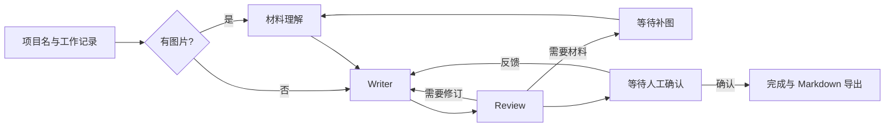

# WeeklyReport Agent

基于 LangGraph 的项目周报 Agent 工作台。输入项目名称和碎片化工作记录，可选附上图片材料，生成五段式周报；通过自动审核、人工反馈和版本对比逐步修订，确认后导出 Markdown。

## 功能

- **文字与可选图片**：文字是主要事实来源；PNG、JPEG、WebP 图片由视觉模型逐张理解，纯文字任务跳过图片理解。
- **五段式输出**：本周完成、进行中、风险与阻塞、下周计划、待确认事项。信息不明确时列入待确认事项。
- **审核与人工修订**：Writer 编写，Review 审核；用户可反馈修改意见，收到补充材料请求时可补图，最终由用户确认。
- **版本与下载**：预览各版 Markdown 和对应图片，下载所选版本；后续补图不会改变历史版本的图片引用。
- **规则与记忆**：规则中心管理写作与审核规则，会话及修订记录用于记忆演进；候选规则达到命中阈值后成为可选用的活跃规则。
- **执行可观测性**：任务看板、工作台事件、本地 Trace；可选接入 Langfuse。

## 工作流程



主流程由 LangGraph 编排；后端使用 FastAPI、SQLite 和本地文件存储，前端使用 React、esbuild、TypeScript 和 Ant Design。详见[架构说明](docs/architecture.md)与[工作流契约](docs/weekly_report_workflow.md)。

## 快速开始

以下命令在仓库根目录使用 PowerShell 执行。需要 Python 3.11+、Node.js 24 LTS以及 pnpm；锁文件格式为 9.0。

### 1. 安装依赖

```powershell
py -3 -m venv .venv
.\.venv\Scripts\python.exe -m pip install --upgrade "pip>=26.2"
.\.venv\Scripts\python.exe -m pip install -e ".\backend[dev]"
pnpm --dir .\frontend install --frozen-lockfile
```

`py -3` 应选择 Python 3.11 或更高版本。如果启动器未登记已安装的 Python，请用该 Python 的 `python.exe` 完整路径执行 `-m venv .venv`。后续运行和安装均使用仓库内的 `.venv\Scripts\python.exe`。

### 2. 配置模型

首次配置时复制示例文件；已有本地配置时直接编辑它：

```powershell
Copy-Item .\backend\config\settings.example.yaml .\backend\config\settings.local.yaml
```

修改 `settings.local.yaml` 中的 `model.base_url`、`model.chat.model`；图片任务还需配置 `model.vision` 的端点和支持图片输入的模型。示例中的 `api.example.com` 和 `your-model-name` 都是占位符。

在仓库根目录创建本地 `.env`，填写对应服务商的真实密钥：

```dotenv
OPENAI_SHARED_API_KEY=replace-with-your-text-model-key
OPENAI_VISION_API_KEY=replace-with-your-vision-model-key
```

配置合并、独立视觉端点及密钥读取规则见[配置说明](docs/configuration.md)。

### 3. 启动前后端

终端一：

```powershell
.\.venv\Scripts\python.exe -m uvicorn app.main:app --reload --app-dir .\backend --host 127.0.0.1 --port 8000
```

终端二：

```powershell
pnpm --dir .\frontend dev
```

- 工作台：`http://127.0.0.1:5174`，首页跳转到 `/tasks`。
- 健康检查：`http://127.0.0.1:8000/healthz`。
- 交互接口文档：`http://127.0.0.1:8000/docs`。

在“新建周报”填写项目名称和工作记录，创建并启动任务，等待周报生成与审核，再提交反馈或确认。完整操作示例见[周报演示指南](docs/demo-guide.md)。健康检查成功只代表应用可用，模型连通性需通过实际任务验证。

## 项目结构

```text
backend/       FastAPI、Agent、LangGraph、存储与测试
frontend/      任务看板、工作台、文件库、规则中心与 Trace 页面
docs/          模板、架构、接口、配置和运行说明
infra/langfuse/ 可选的本地观测服务
data/          本地运行数据，仓库只保留目录占位文件
```

## 文档

- [文档索引](docs/README.md)：架构、接口、配置和运行说明的入口。
- [周报演示指南](docs/demo-guide.md)：用合成材料演示生成、审核、人工修订、版本和下载。
- [接口说明](docs/api.md)：任务控制、异步反馈/补图、版本、文件库、规则和 Trace。
- [周报模板](docs/weekly_report_template.md)：Writer 运行时读取的五段式模板。
- [功能状态](docs/progress.md)：当前能力与开发待办。
- [可选 Langfuse](infra/langfuse/README.md)：本地观测服务配置。

当前运行方式面向本地单用户使用：后台任务由进程内线程池执行，SQLite 检查点保存工作流状态，进程重启不会自动恢复线程池中未完成的作业。部署边界见[架构说明](docs/architecture.md)。
