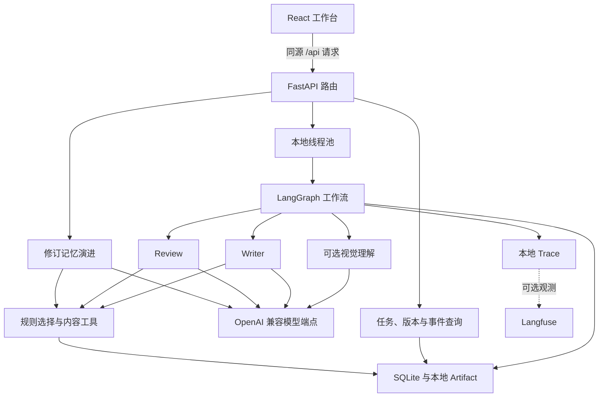

# 架构说明

WeeklyReport Agent 将周报生成、审核和人工决策串成可记录的工作流。用户在工作台查看任务状态、版本、图片材料和执行事件，后端负责模型调用与本地持久化。

## 组件关系

前端使用 esbuild 和 Tailwind PostCSS 构建。Node HTTP 开发服务与本地生产预览均将 `/api` 代理到 FastAPI，并支持浏览器页面路由回退；FastAPI 当前未挂载前端构建目录。正式部署仍需配置静态文件服务与 API 反向代理。

## 代码职责

| 位置 | 职责 |
| --- | --- |
| `backend/app/main.py` | 读取配置，构造模型、存储、线程池、检查点及各服务，注册路由与生命周期 |
| `backend/app/api/` | 创建/控制任务、反馈、确认、补图、查询文件、规则和 Trace |
| `backend/app/workflows/` | 工作流状态、节点及 LangGraph 编排，保存恢复所需检查点 |
| `backend/app/agents/` | 图片理解、周报 Writer、Review 与记忆演进 |
| `backend/app/tools/` | 图片预处理、周报渲染、规则内容读取等工具 |
| `backend/app/services/` | 任务执行、异步操作、查询、Artifact、配置及观测 |
| `backend/app/memory/` | 会话记录、任务快照、规则存取与选择 |
| `backend/app/schemas/` | 周报、材料、审核、任务、操作和前端响应契约 |
| `frontend/src/react_app/` | 页面、工作台交互与展示组件 |

## 工作流与人工决策

创建任务只保存初始状态，调用启动接口后才入队执行。纯文字任务从 `start_workflow` 进入 `write_report`；有图片时先执行 `material_understanding`。Review 决定继续修订、等待补充材料或等待人工确认，具体状态与契约见[工作流程](weekly_report_workflow.md)。

等待期间，反馈接口接收修改意见；补图接口仅在等待材料时可用。最终确认要求当前审核条件满足，后端继续执行到完成并保存最终 Markdown。暂停与取消通过任务状态在执行边界生效，无法保证立即中断正在进行的模型网络请求。

## 存储

| 默认位置 | 内容 |
| --- | --- |
| `data/sqlite/weekly_report.db` | 任务、版本、Artifact 索引、会话、规则和操作记录等业务数据 |
| `data/sqlite/langgraph_checkpoints.db` | 与业务数据库同目录的 LangGraph 检查点 |
| `data/artifacts/` | 上传图片、材料清单、周报文件、会话与规则等文件内容 |
| `data/logs/weekly_report.log.jsonl` | 应用结构化日志，支持按大小轮转 |

路径可在配置中修改，相对路径以仓库根目录解析。任务的文件索引与实际文件共同组成完整数据；备份时应在停止任务后一起保存数据库、检查点和 Artifact 目录。

每个周报版本保存当时的 `material_refs`。历史版本展示自己的图片引用，后续补图不会追加到旧版本。Markdown 正文与图片预览分开：版本接口返回 Markdown 字符串和图片 URL，前端将所选版本的字符串生成为下载文件。

## 规则、模板与观测

Writer 和 Review 通过规则选择器获得活跃规则摘要，并按需使用工具读取内容。导入规则最初是 `candidate`；记忆演进可累积命中，达到阈值后晋升为 `active`。当前规则管理接口提供列表、导入、编辑和删除，没有直接切换规则状态的接口。

规则触发条件包含 `task_type`、`agent_stage`、`report_section`、`issue_type`；当前选择器以任务类型、阶段和问题类型匹配，段落条件参与排序。文件库的模板上传用于保存资料，Writer 的运行模板固定读取 [weekly_report_template.md](weekly_report_template.md)，任务中的 `template_name` 元数据不会绑定某个上传模板。

本地事件和 Trace 可以独立使用。Langfuse 是可选观测后端，启用后可记录模型与阶段追踪；输入输出采集默认关闭。配置见[配置说明](configuration.md)与 [Langfuse 指南](../infra/langfuse/README.md)。

## 运行边界

当前实现面向本地单用户工作台，没有账户认证、租户隔离或对外服务的部署配置。默认仅监听回环地址。若自行部署到共享环境，需另行实现访问控制、上传限制和代理配置。

`local` 使用 `ThreadPoolExecutor`，默认最多两个工作线程。`redis` 虽出现在配置类型中，实现仍为占位，不能作为可用执行后端。数据库检查点支持保留状态，不等同于持久化作业队列：进程退出后未完成的线程池作业不会自动重新调度。启动时会将中断的反馈/补图操作标记失败，并尽可能恢复该操作之前的任务快照。不支持以多个 Uvicorn worker 共享本地任务调度。
